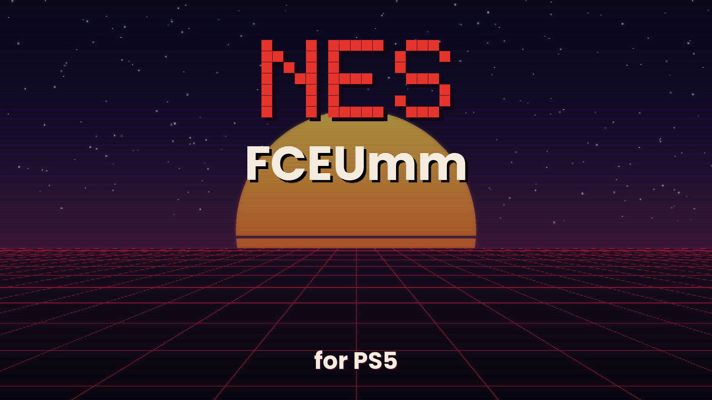

# NES FCEUmm PS5

[FCEUmm](https://github.com/libretro/libretro-fceumm) -- the libretro NES / Famicom emulator with the widest
board support (FCE Ultra "mappers modified") -- running on a jailbroken PS5 as a **native home-screen app** with its
own icon and background, with the best of **Mesen** and **Nestopia** added for accuracy: Mesen's game database to
correct bad ROM headers, Mesen's and Nestopia's palettes, and Mesen's HD packs. One app plays:

| System | Files | BIOS needed (in `/data/fceumm/bios/`) |
|---|---|---|
| NES / Famicom (cartridges, VS. System games included) | `.nes` `.unf` `.unif` | none |
| Famicom Disk System | `.fds` | `disksys.rom` |

Games can also be inside a `.zip`. A disk started without the BIOS says which file is needed, and where it goes,
on the screen.

**Inside the emulator, to access the main menu press L3 + R3.**

The PS5 layer follows the layout of PS5SX2 (the PCSX2 port) and of Genesis Plus GX PS5, Snes9x PS5 and FBNeo PS5,
the ports it comes from:

- `ps5/coreorbis` holds `main-boot.cpp`, the `orbis-shims/` and `include-orbis/`;
- `ps5/frontend` holds the user interface, the 3D game shelf and the glue to the FCEUmm core;
- `ps5/proto/native` builds and signs `eboot.bin`;
- `ps5/installer` is the installer and helper payload.

Everything outside `ps5/` is the original libretro-fceumm source, unchanged, apart from this README (the original
one is [README-FCEUmm.md](README-FCEUmm.md)). The core (`src/`: the CPU, PPU, APU, the 432 board files of
`src/boards/`, the Disk System, VS. System, Blargg's NTSC filter, the Mesen-format HD pack renderer) and its
libretro port (`src/drivers/libretro/libretro.c`) are compiled as they are. The frontend drives the core through its
libretro interface and plays the part RetroArch plays on a PC.

> **Status (1.0):** builds with the ps5-payload-dev SDK into a signed native app, and passes 246 host tests, which
> run the same code (the FCEUmm core included) on Linux with the PS5 calls simulated: a hand-assembled NES test
> program is played through the whole chain -- the shelf, the pad, the core, the video and sound output -- as an
> NES 2.0, iNES 1.0 and UNIF file, in NTSC and PAL, from a zip and as a Disk System image. It has not yet been run
> on a console. If something fails, the logs in `/data/fceumm/logs/` say where.

## What it takes from Mesen and Nestopia

FCEUmm is the core: it knows the most boards (including many unlicensed and pirate ones), runs on the PS5's CPU
with a lot of headroom, and its libretro port is complete. The other two emulators are more accurate in places;
what of them could be added without replacing the core, is:

- **Header corrections from Mesen's game database.** Many NES dumps carry an old iNES header that gives the wrong
  mapper, mirroring, battery or region, or can't describe the board at all (submapper, PRG-RAM, CHR-RAM). FCEUmm
  corrects the games it knows (`src/ines-correct.h`). Mesen's database -- NewRisingSun's NES 2.0 header database,
  NesCartDB and Nestopia's database, merged -- knows 9,361 more (its validated entries, for boards FCEUmm has).
  Before a game starts, a ROM with an iNES 1.0 (or older) header whose PRG + CHR CRC32 is in that table gets an
  NES 2.0 header made from it, in memory (the file is not changed), as Mesen does; FCEUmm then sets the board up as
  described. NES 2.0 headers are trusted as they are. `boot.log` says what changed (`header corrected from Mesen's
  database: mapper 4 -> 118.0, ...`). Settings, **Fix headers**, turns it off.
- **Palettes.** The default is **Mesen's palette**. Also built in: Mesen's Nestopia RGB and FirebrandX presets
  (Original Hardware, PVM Style, Unsaturated v6), Nestopia's palette files (Nostalgia, Hybrid, NTSC), and FCEUmm's
  own twenty (FCEUX, Nintendo RGB PPU, Sony CXA2025AS, NESCAP, Wavebeam, the other FirebrandX palettes, Wii VC...).
- **HD packs** in Mesen's format (`hires.txt`), drawn by the core: see [HD packs](#hd-packs).

## How it works

The PS5 gives the controller only to the app in front, so NES FCEUmm PS5 runs as a native app opened from its icon,
and the payload you send is its installer:

| Piece | What it is | In PS5SX2 |
|---|---|---|
| `eboot.bin` in `/data/homebrew/PPSA99013/` | **FCEUmm itself**, a native app opened from its icon | PCSX2 (PPSA99203) |
| `sce_module/libc.prx` | the C runtime module every native app carries | the same file, byte for byte |
| `NESFCEUmmPS5.elf` (payload) | the **installer**: installs or updates the app, then stays running as the **helper** | PS5SX2Installer.elf + PS5SX2Helper.elf |

When it opens, the app asks the helper to let it out of its sandbox; without that an app sees neither `/data`
nor USB drives. The request is the one PS5SX2 makes:

- **Who is asked, in order:** the NES FCEUmm helper (127.0.0.1:9085), then etaHEN (9028) and the daemon on port
  9069.
- **If nobody answers:** the app carries a copy of the helper (`NESFCEUmmPS5-helper.elf`), sends it to the ELF
  loader (127.0.0.1:9021) and asks again. So the icon keeps working after a reboot, as long as the ELF loader
  runs.
- **What the helper allows:** only title PPSA99013. It gives the process the system's root folder and uid 0, as
  elfldr does for payloads. No other app is touched.

NES FCEUmm PS5 only uses `/data/fceumm/`, `/data/homebrew/PPSA99013/` and its own `/user/appmeta/PPSA99013/`. It
sits next to Snes9x PS5 (PPSA99009, helper port 9083), Mesen2 PS5 (PPSA99010, port 9076), Genesis Plus GX PS5
(PPSA99011, port 9084), FBNeo PS5 (PPSA99012, port 9082) and PS5SX2 (PPSA99203) without touching them.

## Versions

Every release carries its version in the file name: `NESFCEUmmPS5-v1.0.elf` and `fceumm-ps5-v1.0-src.zip`
(`make dist`). When updating, replace the old ELF with the new one in your autoload or Payload Manager. In this
README, "`NESFCEUmmPS5.elf`" always means the current release's ELF.

**1.0:** the first release, with what the other ports learned built in: covers downloaded in the background by the
helper with its own HTTPS (Mbed TLS), CRT shaders, saves per system, the debug logs setting.

**1.0.1:** interface languages (English, Spanish, Portuguese (Brazil), French, German); the debug logs are off by
default.

## Language

English (the default), Spanish, Portuguese (Brazil), French or German: Settings -> **SYSTEM** -> **Language**
(Left / Right), saved as `language=0`...`4` in `fceumm-ps5.ini`. Menus, settings, messages and notifications follow
it at once; the logs stay in English.

## Requirements

- A jailbroken PS5 with **kstuff** (or kstuff-lite) and an **ELF loader** on port 9021: elfldr, etaHEN, or the
  one PS5 Payload Manager uses.
- **ShadowMountPlus**, so the icon appears on the home screen (the same one PS5SX2 uses).
- Your own games, and the Famicom Disk System BIOS (`disksys.rom`, 8 KiB) for disk games. None are included.

## Install and play

1. **Send `NESFCEUmmPS5.elf`** with PS5 Payload Manager, or from a PC on the same network:
   ```sh
   nc -q0 PS5_IP 9021 < NESFCEUmmPS5-v1.0.elf
   ```
   It installs the app in `/data/homebrew/PPSA99013/` (`eboot.bin`, `sce_module/libc.prx`, `param.json`, the
   icon and the backgrounds), shows **"NES FCEUmm PS5 1.0 installed. Open it from the NES FCEUmm PS5 icon on the
   home screen."** and stays running as the helper.
2. **Open the NES FCEUmm PS5 icon.** The game shelf appears and the controller works.
3. **Copy your games** to their system's folder, over FTP for example. The app makes the folders on its first
   start:

   | System | Games in | Your covers in |
   |---|---|---|
   | NES / Famicom | `/data/fceumm/roms/NES` | `/data/fceumm/covers/NES` |
   | Famicom Disk System | `/data/fceumm/roms/FDS` | `/data/fceumm/covers/FDS` |

   On a USB drive the same layout goes under `fceumm/roms` (`fceumm/roms/NES`...). Subfolders inside them are fine
   (`roms/NES/RPG/`). The game's system comes from its extension, so a game left directly in `roms/` or in another
   folder is still found. The Disk System BIOS goes to `/data/fceumm/bios/disksys.rom`.

Tip: put `NESFCEUmmPS5.elf` in your autoload, as PS5SX2 recommends for its payloads.

**Updating:** send the new `NESFCEUmmPS5.elf` once. It compares every app file with the copy it carries and
rewrites only what changed; each file is written to a temporary file and then renamed, `eboot.bin` last. A deleted
or damaged icon is put back the same way. A second copy sent while the helper is already running only installs and
exits.

**If "NES FCEUmm PS5 has no access to /data" appears:** no helper answered and the ELF loader wasn't running.
Send `NESFCEUmmPS5.elf` and open the icon again.

| Folder | Contents |
|---|---|
| `/data/fceumm/roms/<system>` | your games: `NES`, `FDS` |
| `/data/fceumm/bios` | `disksys.rom` for the Disk System; `HdPacks/` (see [HD packs](#hd-packs)) |
| `/data/fceumm/saves` | battery saves, one folder per system: `saves/NES/<game>.srm`; for a disk, `saves/FDS/<game>.srm` is the disk with what the game wrote to it (the `.fds` file itself is never changed). Written within 3 seconds of a change and when the game closes, an erase included |
| `/data/fceumm/states` | save states, one folder per system: `states/NES/<game>.state1` to `.state10` (a cartridge and a disk of the same name never share one) |
| `/data/fceumm/covers/<system>` | downloaded covers and your own, one folder per system (the same names as in `roms/`); `covers/` itself keeps `wanted.txt` and `crc-cache.txt` |
| `/data/fceumm/logs` | `boot.log` (the app), `installer.log` (installer/helper), `helper.log` (the helper the app starts), and the previous session's `.prev.log` files |
| `/data/fceumm/fceumm-ps5.ini` | the menu settings |

### The home-screen app

```
/data/homebrew/PPSA99013/
  eboot.bin              FCEUmm (a native app, signed as PS5SX2's is), with the helper inside
  sce_module/libc.prx    the native app's C runtime (the same as PS5SX2's and ps5-native-app-boilerplate's)
  sce_sys/param.json     title "NES FCEUmm PS5", ID PPSA99013
  sce_sys/icon0.png      the icon: the "NES FCEUmm for PS5" art (512x512; ps5/app/sce_sys/icon0.png in the source)
  sce_sys/pic0.dds       the home-screen background while the icon is selected (3840x2160, BC7)
  sce_sys/pic1.dds       the launch background (the same image)
```

The icon is the project's official art, `ps5/app/sce_sys/icon-source.png` (512x512): an NES pad under the "NES
FCEUmm for PS5" title; `icon0.png` is the same image. To change the icon, replace `ps5/app/sce_sys/icon0.png`
(512x512 PNG) and rebuild. The background -- the large image behind the icon when NES FCEUmm PS5 is selected on
the home screen -- is the project's background art, `ps5/app/sce_sys/background-source.png` (3840x2160: an NES
console, its box and pad under the "NES FCEUmm for PS5" title), encoded to `pic0.dds`/`pic1.dds` as BC7
(bc7enc_rdo, as ps5-native-app-boilerplate's `tools/prepare-assets.sh --background` does). For another title ID:
`make ps5 TITLE_ID=XXXX00000`.

**Home-screen art:** ShadowMountPlus copies the art in `sce_sys` (icon, backgrounds, `param.json`) to
`/user/appmeta/PPSA99013/` only when it first registers the title, and the system keeps the art it saw at that
moment. The installer keeps that folder current on every update, but if the title was registered before the art
changed, register it again once: select **NES FCEUmm PS5** on the home screen, press **OPTIONS**, choose
**Delete** (your games, saves and covers in `/data/fceumm/` stay), then send `NESFCEUmmPS5.elf` again.

## The game shelf and covers

The start screen is a 3D shelf of game covers, like PS5SX2's and Snes9x PS5's, with the author's line under the
wordmark: **github.com/MisterTemaki**.

- **All your games at once:** the shelf gathers the games in `/data/fceumm/roms` (its system folders) and on USB
  drives (`fceumm/roms`), subfolders included, sorted by name. Each game's line says its system and region.
- **Tabs by first letter:** the NES library is huge, so **Up / Down** go through **All games**, **#** (the games
  whose names start with a number, or with a letter of another script) and **A** to **Z** -- only the letters that
  have games are shown. A game goes by the first letter or digit of its name (`'89 Dennou Kyuusei Uranai` is under
  #, `The Legend of Zelda` under T); Disk System games are in their letter's tab with the cartridges. The shelf
  remembers the last tab.
- **Official names:** a game is identified by its file name or, when that doesn't match, by the ROM's CRC32,
  looked up in a table of 13,960 CRCs built into the app (No-Intro, from libretro-database: about 7,000 NES and
  Disk System games, each with and without its header).
  - The CRC is tried on the whole file, then without its 16-byte header (iNES, NES 2.0 or fwNES).
  - Loose names (`super mario bros.nes`) are recognised too.
  - CRCs are cached in `covers/crc-cache.txt`, so each ROM is read once.
- **Automatic covers, in the background:** box art comes from
  [libretro-thumbnails](https://github.com/libretro-thumbnails) (each system's `Named_Boxarts`) over HTTPS.
  - The console's own HTTPS (`libSceHttp2`/`libSceSsl`) only works inside the app's sandbox, and the app can't
    see `/data` until it is out of it. So the **helper** downloads the covers, while you use the app, with HTTPS of
    its own: Mbed TLS, the server's certificate checked against Mozilla's list of certificate authorities, one
    connection kept for all the downloads. The app opens at once and lists the missing covers in
    `/data/fceumm/covers/wanted.txt`, and the ones around the selection in `covers/priority.txt` (fetched first);
    the helper downloads them one by one, and each cover replaces its card on the shelf as it lands. The top right
    corner shows "Downloading covers in the background... N left". The helper keeps going while the app is closed.
  - New games get their covers the same way the next time the app starts.
  - With another jailbreak daemon instead of the NES FCEUmm helper (etaHEN, 9069): a prefetch before the app asks
    for `/data` (30 s), and a restart when new games need covers.
  - Covers are saved in their system's folder, `covers/<system>/<name>.png`
    (`covers/NES/Super Mario Bros. (World).png`), and never downloaded twice. A cover the server doesn't have is
    marked (`.missing`) and only looked for again after 30 days; **Square** forces a new try.
  - Without a network nothing is tried and the shelf works the same.
- **Your own covers:** a `.png` or `.jpg` named after the ROM file, in `/data/fceumm/covers/<system>/`
  (`covers/NES/Mario.png` for `roms/NES/Mario.nes`), in `covers/` itself, or next to the ROM, takes priority over
  downloads.
- **No cover:** the game gets a card with its title and system.
- **Turning downloads off:** Settings, "Download covers".

### Downloading all the covers yourself

To fill the shelf without the console downloading anything (an offline PS5, or a big library), download each
system's whole cover set from [libretro-thumbnails](https://github.com/libretro-thumbnails) on a PC:

| System | All covers at once (zip) | Browse | Copy the images to |
|---|---|---|---|
| NES / Famicom | [master.zip](https://github.com/libretro-thumbnails/Nintendo_-_Nintendo_Entertainment_System/archive/refs/heads/master.zip) | [Named_Boxarts](https://github.com/libretro-thumbnails/Nintendo_-_Nintendo_Entertainment_System/tree/master/Named_Boxarts) | `/data/fceumm/covers/NES/` |
| Famicom Disk System | [master.zip](https://github.com/libretro-thumbnails/Nintendo_-_Family_Computer_Disk_System/archive/refs/heads/master.zip) | [Named_Boxarts](https://github.com/libretro-thumbnails/Nintendo_-_Family_Computer_Disk_System/tree/master/Named_Boxarts) | `/data/fceumm/covers/FDS/` |

1. Download the zip and unpack it on the PC. The covers are in its **`Named_Boxarts`** folder (the zip also has
   title screens and in-game shots: they are not used).
2. Copy the `.png` files from `Named_Boxarts` (not the folder itself) to that system's `covers/` folder, over FTP
   for example. Copying only the covers of the games you have saves space: the zips are large.
3. Open the app: games recognised by name or CRC pick their cover up at once, and nothing is downloaded for them.

Notes:

- The files keep their official names (`Super Mario Bros. (World).png`); the app looks for exactly that name, with
  the characters `` & * / : ` < > ? \ | " `` replaced by `_` as in the repository. `boot.log` lists the name it
  found for each game (`[games] ... -> "<name>"`).
- A few `.png` files in the repository are git links: a small text file holding the name of another cover. In the
  zip they may come out as text, not images; copy the cover they name under that file's name instead.
- One cover: `https://raw.githubusercontent.com/libretro-thumbnails/<repository>/master/Named_Boxarts/<name>.png`
  (spaces as `%20`).

The shelf is drawn by the CPU in real 3D perspective (each cover a quad turned about the vertical axis, drawn
column by column with bilinear filtering, mipmaps and anti-aliased edges, split across several cores), as in
Snes9x PS5.

## Controls

**Inside the emulator, to access the main menu press L3 + R3.**

**On the shelf**

| Button | Does |
|---|---|
| Left / Right (D-pad or stick) | change game (hold to speed up) |
| Up / Down | change tab (All games, #, A ... Z) |
| L1 / R1 | skip 10 games |
| Cross | play |
| Triangle | settings |
| Square | download this game's cover again (the cover it has stays until the new one has arrived) |
| OPTIONS | quit NES FCEUmm PS5 (asks first) |

**In a game:** by default, buttons by position, as RetroArch maps them -- the NES pad's B and A on Cross and
Circle, their turbo versions above them. Every button can be moved (Settings, **CONTROLS**, below).

| PS5 | NES / Famicom |
|---|---|
| Cross | B |
| Circle | A |
| Square | Turbo B |
| Triangle | Turbo A |
| OPTIONS | Start |
| touchpad click | Select |
| L1 | Disk System: next disk side (eject, turn the disk, insert it again a second later) |
| R1 | Disk System: eject / insert the disk |
| none (set one in the settings) | VS. System: insert a coin |
| D-pad or left stick | D-pad |

| Combination | Does |
|---|---|
| L3 + R3 | pause menu: save / load state, slot, disk side, disk in / out, insert coin, settings, reset, power cycle, back to the list, quit |
| L2 + Up / Down | save / load the state in the current slot |
| L2 + Left / Right | change slot (1-10) |
| hold R2 | fast forward (speed in the settings) |
| hold L2 + R2 | rewind |

Up to four players: player 2 is the second signed-in user's controller, players 3 and 4 the third and fourth.
Games made for four players (the Four Score or the Famicom's adapter) get it plugged in by FCEUmm on its own. The
light bar shows the player.

## Settings

Triangle on the shelf, or "Settings" in the pause menu:

- **Video:** **shader** (see [CRT shaders](#crt-shaders); CRT Easymode style by default), screen size (fit to
  screen, integer scale, stretch to 16:9), aspect ratio (TV -- 8:7 pixels, as on a television --, 4:3, square
  pixels, 16:9), **palette** (Mesen's by default; 28 in all, see above), **NTSC filter** (Blargg's: composite,
  S-Video, RGB, monochrome), **overscan** (hide 8 lines top and bottom as a TV did -- the default --, show
  everything, or hide 8 pixels on every edge), **HD packs**, smooth picture and scanlines (for the plain picture,
  with the shader Off), FPS counter.
- **Audio:** sound on/off, volume, **sound quality** (Low, High, Very high -- the most accurate, the default), low-pass
  filter.
- **Emulation:** fast-forward speed (150% to unlimited), rewind on/off, **console region** (Auto -- from the
  header, the database or the file name --, NTSC, PAL, Dendy), **remove the sprite limit** (no more flicker where
  more than 8 sprites share a line; a few games use the limit on purpose), **RAM at power-on** ($FF as FCEUmm does,
  $00, or random -- a few games behave differently on real consoles), **Fix headers** (Mesen's database, On by
  default). The last two apply when a game next starts.
- **Controls:**
  - **Turbo speed:** how often Turbo A / Turbo B press their button (30 to 1 presses a second; 15 by default).
  - **Button layout:** for each NES button (A, B, Turbo A, Turbo B, Start, Select) and for the Disk System's side
    and in/out buttons and the VS. System's coin, the PS5 button that presses it: Cross, Circle, Square, Triangle,
    L1, R1, OPTIONS, the touchpad, or none. **Default button layout** puts them back. The layout applies to every
    player (the disk and coin buttons to player 1). L2, R2, L3 and R3 stay for the hot keys and menus, and the
    menus always use Cross / Circle.
  - Changes apply at once, in the game too, and are saved in `fceumm-ps5.ini` (`turbo`, `btn_a`...`btn_coin`).
- **Library:** download covers.
- **System:** **Language** (see [Language](#language)); **Debug logs** (Off by default since 1.0.1) -- see
  [Debugging](#debugging-logs-and-crashes).

The settings go to the core as its libretro options (`fceumm_*`), so they behave as in RetroArch.

## HD packs

FCEUmm draws HD packs in **Mesen's format** (`hires.txt` and its PNG files), replacing the game's tiles with
high-resolution ones and adding the pack's backgrounds and music where the core supports them.

1. Put each pack in `/data/fceumm/bios/HdPacks/<ROM name>/`, named exactly as the ROM file without its extension:
   ```
   /data/fceumm/bios/HdPacks/Super Mario Bros. (World)/hires.txt
   /data/fceumm/bios/HdPacks/Super Mario Bros. (World)/*.png
   ```
2. Settings, **HD packs** On (the default), and start the game. The setting applies when a game next starts.

Good to know: HD packs are made for one exact ROM (most say which in `hires.txt`); a pack for another dump may show
wrong tiles. Large packs take memory and time to load; `boot.log` shows the core's lines about the pack (`[core]
...`). This support comes from FCEUmm's own HD pack renderer; on the PS5 it has been checked against the core's
code, not yet with a real pack on a console.

## CRT shaders

Every game starts through a CRT shader -- **CRT Easymode style** unless you pick another one. Eleven shaders are
built in; they work on every game and only while a game is running (the shelf is drawn without them).

**How to use them**

1. **In a game:** press **L3 + R3** to open the pause menu and choose **Settings** (on the shelf: **Triangle**).
2. **Shader** is the first row: **Left / Right** (or **Cross**) go through the list. The picture behind the menu
   changes at once, so you can compare them on the game you are playing.
3. **Circle** closes the settings; the choice is saved and used for every game from then on.
4. **Off** gives the plain picture; with it, the "Smooth picture" and "Scanlines" options apply (with a shader on,
   the shader does that work).
5. The choice is kept in `/data/fceumm/fceumm-ps5.ini` as `shader=<number>` (the numbers below): you can also
   set it there by hand.

| `shader=` | Shader | Look | Weight | From |
|---|---|---|---|---|
| 0 | Off | the plain picture | -- | -- |
| 1 | **CRT Easymode style** (default) | flat screen, sharp, scanlines that widen on bright colours, aperture grille | medium | written for these ports, after the look of EasyMode's crt-easymode |
| 2 | crt-lottes | curved screen, Gaussian beam, shadow mask, a little bloom | heavy | Timothy Lottes (public domain) |
| 3 | crt-lottes-fast | lighter Lottes: curved, 4-tap beam, aperture mask, tone mapping | medium | Timothy Lottes (public domain) |
| 4 | crt-1tap | very light, contrasty dynamic scanlines | light | fishku (CC0) |
| 5 | crt-2tap | crt-1tap with exact blending between two lines | light | fishku (CC0) |
| 6 | crt-hyllian-fast | sharp Catmull-Rom picture, strong scanlines, magenta/green dot mask | medium | Hyllian (MIT) |
| 7 | crt-nobody | curved screen with rounded corners, beam scanlines, magenta/green mask | heavy | Hyllian (MIT) |
| 8 | newpixie-mini | strongly curved TV, colour bleed, vignette, film tone | heavy | Mattias Gustavsson (Unlicense) |
| 9 / 10 | crt-blurPi-sharp / crt-blurPi-soft | light blur and screen-space scanlines (sharp or bilinear) | light | Oriol Ferrer Mesià (MIT) |
| 11 | monoCRT | a monochrome monitor (made for black-and-white pictures) | light | hunterk (public domain) |

Which to pick: **CRT Easymode style** for a sharp, flat monitor look; **crt-hyllian-fast** for stronger scanlines
and a visible dot mask; **crt-lottes** or **crt-nobody** for a curved TV; **crt-1tap / crt-2tap** when a game
should stay as light as possible. With the **NTSC filter** on, a light shader (or Off) keeps the filter's
composite look readable.

They come from libretro's [slang-shaders](https://github.com/libretro/slang-shaders) (`crt/`), with their default
parameters. The PS5 build draws the picture with the CPU (there is no GPU driver for homebrew apps), so only
single-pass shaders are fast enough; multi-pass shaders (crt-royale, crt-guest-advanced, the Mega Bezel...) need a
GPU. Each shader is rewritten in C++ (`ps5/coreorbis/orbis-shims/ProsperoCrt.cpp`) and shared by up to six
threads. Every minute in a game, `boot.log` says how long the shader took per frame (`shader N ms`).

## Picture and sound

- 1920x1080 output through `libSceVideoOut`, flipping on vsync. With little video memory it falls back to
  1280x720.
- The core runs one frame per call on the frontend's thread; its 32-bit frames (256x240, or 602 pixels wide with
  the NTSC filter, larger with an HD pack) are scaled and shown with the HUD.
- Sound through `libSceAudioOut` at 48 kHz, on its own thread. The core's 48 kHz sound goes through a small rate
  control (within 0.5%) that keeps about 60 ms queued, so the NES's 60.1 Hz plays without crackles on a 60 Hz TV.
  NTSC games are paced by the display, PAL and Dendy games (50 Hz) by the sound clock, so they run at their real
  50 frames a second.
- Fast forward runs several frames per display frame, muted; rewind keeps a snapshot every 3 frames (up to 192 MB).

## Debugging (logs and crashes)

**Turning the logs on or off:** Settings (Triangle on the shelf, or L3 + R3 -> Settings in a game) -> **SYSTEM**
-> **Debug logs**. Off stops every log at once: the app writes nothing more to `boot.log` (its last line says the
logs were turned off) or to the console output, and the next starts -- the app, the installer and the helper --
write no log files at all; the files of earlier runs are left as they are. On starts again at once, adding to
`boot.log`. The setting is `debug_logs=0` / `debug_logs=1` in `fceumm-ps5.ini`; it is off by default (1.0.1).
Turn it on if you want to report a problem: with them off there is no log to send, and no `== CRASH ==` report either.

If something fails, send the files in `/data/fceumm/logs/`: `boot.log` (the app), `installer.log` and
`helper.log`, plus the previous session's `.prev.log` files. They record every step:

- the sandbox request and who answered;
- the covers, one by one (`helper.log`: the background downloads; `boot.log`: the prefetch, when there is one);
- every `sceVideoOut*` call, and the picture's size and place on the screen;
- the controller handle and its first read;
- the games found, with their system and name;
- the core's own log (`[core] ...`: the ROM it loaded, its header and board, the BIOS, its errors), any header
  correction and any missing BIOS;
- frames per second, queued audio and underruns, and the shader's time per frame, every minute in a game.

If the app dies on a signal (the PS5's "Game or App Error" screen), a `== CRASH ==` block is written at the end
of `boot.log`: the signal, the address, the **stage** each part of the program was in (`stage[...]`: boot, shelf,
covers, emu, menu), and the return addresses, which map into `ps5/build/app/fceumm-pie.elf`.

## Known limitations

- The PS and Create buttons are not reported by `scePadReadState`, so Select is on the touchpad by default (and the
  button layout can't use them).
- No Zapper or other light guns, Arkanoid paddle, Power Pad or Famicom keyboard, although the core supports some
  of them; no cheats (Game Genie, codes) in the frontend yet; no `.nsf` music files.
- VS. System games: the coin works, their DIP switches keep FCEUmm's defaults.
- `.7z` archives are not read (`.zip` is).

## Building

Requirements: the [ps5-payload-dev SDK](https://github.com/ps5-payload-dev/sdk) v0.42 or newer, clang/lld 18, and
g++ with ASan for the tests.

```sh
export PS5_PAYLOAD_SDK=/opt/ps5-payload-sdk
cd ps5
make ps5 -j$(nproc)              # build/ps5/NESFCEUmmPS5.elf (installer + helper, with the app inside)
make send PS5_HOST=192.168.0.10  # sends it to elfldr (port 9021)
make dist                        # build/dist/NESFCEUmmPS5-v<version>.elf + the source zip
make app                         # only build/app/PPSA99013/, to copy by hand
make test                        # Linux builds (app, installer, helper) + 246 host tests (ASan/UBSan)
```

The build has three stages:

1. `NESFCEUmmPS5-helper.elf`, the helper alone.
2. `eboot.bin`: a PIE with the boilerplate's `app_crt.cpp`, the FCEUmm core with its libretro port, and the
   frontend.
   - The core is compiled with the flags of its `Makefile.libretro` for a 32-bit-colour frontend
     (`FRONTEND_SUPPORTS_RGB888`), with the NTSC filter (`HAVE_NTSC_FILTER`) and HD packs (`HAVE_HDPACK`, with
     libretro-common's PNG decoder and zlib).
   - It is linked against the SDK's stubs and static libc++, with `ps5-pie.ld` + `ehframe.ld` and every symbol
     local.
   - Then it goes through `ps5-native-tool link` and `self --sign`, exactly like PS5SX2's `link-vk.sh`.
   - `libc.prx` goes with it, generated by `libc_builder` and checked against the published SHA-256
     (`ps5/proto/native/libc.prx.sha256`).
3. `NESFCEUmmPS5.elf`, with the app folder built in.

The data built into the app is made by scripts in `ps5/tools/`: `make_gamedb.py` (`data/nointro.tsv`, from
libretro-database), `make_nesdb.py` (`data/nesdb.tsv`, from Mesen's `MesenNesDB.txt` and FCEUmm's own corrections)
and `make_palettes.py` (`fe_palettes.h`, from Mesen's and Nestopia's sources).

## Source layout

- **`ps5/coreorbis/main-boot.cpp`**: the app's entry point (`eboot.bin`). Asks to leave the sandbox, brings up
  log, folders, video, sound and pads, starts the core, and hands over to the frontend on a thread with an 8 MiB
  stack. Exits through the system (`sceSystemServiceLoadExec("exit")`), as PS5SX2 does.
- **`ps5/installer/installer_main.cpp`**: `NESFCEUmmPS5.elf` (installs the app and stays as the helper) and,
  built with `FCEUMM_HELPER_ONLY`, `NESFCEUmmPS5-helper.elf`.
- **`ps5/coreorbis/orbis-shims/`**: the PS5 layer.
  - `ProsperoVideo.cpp`: `libSceVideoOut`, direct memory, two scan-out buffers, AVX2 tiling, the scaler (fit /
    integer / stretch, smoothing, scanlines) and the HUD overlay;
  - `ProsperoCrt.cpp`: the CRT shaders on the CPU, and their thread pool;
  - `ProsperoAudio.cpp`: `libSceAudioOut`, lock-free ring buffer, output thread;
  - `ProsperoInput.cpp`: `libScePad` + `libSceUserService`, several players, read from any thread;
  - `ProsperoJailbreak.cpp` / `ProsperoHelper.cpp`: both sides of the sandbox request and the covers list;
    `helper_data.cpp` builds the helper into the app;
  - `ProsperoInstall.cpp` + `install_data.cpp`: the app folder built into the installer, the install, and the
    `/user/appmeta` art;
  - `ProsperoCrash.cpp`: the crash printer and stage markers;
  - `ProsperoNotify.cpp`: system notifications;
  - `orbis_paths.cpp`: `/data/fceumm`, USB drives and the logs.
- **`ps5/coreorbis/include-orbis/ProsperoSce.h`**: prototypes of the system functions (the SDK ships the import
  stubs but not the headers).
- **`ps5/frontend/`**:
  - `fe_emu.cpp`: the libretro frontend -- the core's environment calls (folders, options, log, the game in
    memory), its video, audio and input callbacks, the pacing, battery saves, save states, rewind, the hot keys,
    turbo, the disk drive and coin buttons, the palettes and the BIOS check;
  - `fe_nes.c`: the few calls into FCEUmm's own API the libretro interface doesn't offer (disk side, coin, the
    palette, the game's type);
  - `fe_nesdb.cpp` + `data/nesdb.tsv`: the header corrections from Mesen's database;
  - `fe_palettes.h`: Mesen's and Nestopia's palettes;
  - `fe_games.cpp` + `data/nointro.tsv`: the library, systems, the letter tabs, zips and names;
  - `fe_shelf.cpp`, `fe_covers.cpp`, `fe_prefetch.cpp`, `fe_http.cpp`: the 3D shelf and covers;
  - `fe_coverworker.cpp`, `fe_coverfetch.cpp`: the helper's background downloads, and the fetch code the app and
    the helper share;
  - `fe_tlshttp.cpp`, `fe_mbedtls_config.h`, `data/cacert.pem`: the helper's own HTTPS client (sockets, Mbed TLS,
    Mozilla's CA list);
  - `fe_menu.cpp`, `fe_settings.cpp`, `fe_text.cpp`: menus, settings, text with PS5SX2's fonts;
  - `third_party/`: minizip (unzip.c, ioapi.c), as in Snes9x; Mbed TLS 3.6.7 (`mbedtls/`, its `include/` and
    `library/` as released).
- **`ps5/third_party/zlib`**: zlib, for the zips, the CRCs and the HD packs' PNG files.
- **`ps5/proto/native/`**: ps5-native-app-boilerplate's tools (BlackBearReloaded, GPL-3.0), taken from PS5SX2
  and PS5_Vulkan (mihawk-99): `ps5-native-tool`, `app_crt.cpp`, `ps5-pie.ld`, `libc_builder.cpp` and its
  manifests.
- **`ps5/app/sce_sys/`**: param.json, icon and backgrounds.
- **`ps5/host/sce_host.cpp`** and **`ps5/tests/`**: the PS5 functions implemented on Linux, a hand-assembled 6502
  test program (`make_test_rom.py`: red picture, green while B is held, a square-wave tone; NES 2.0, iNES 1.0, UNIF,
  PAL, battery RAM, a Disk System image) and the 246 tests: picture and input in each format, PAL timing, the Disk
  System BIOS message and its disk buttons, save states, zip, sound latency, integer scale and scanlines, the
  shelf's letter tabs, the system folders, the controls (button layout, turbo, the settings screen), the CRT
  shaders (the default, each one drawing under ASan/UBSan, the menu), settings, fast forward and rewind, covers per
  system (names by CRC), install, helper and sandbox request (unknown titles refused, slow clients, links), saves
  per system and their integrity (an erased battery save written, unchanged ones left alone), odd library files,
  long paths, covers kept offline, downloads after a tab change, the debug logs setting, the helper's HTTPS (a
  local server with a test certificate authority), and accuracy: a header corrected from Mesen's database (and
  left alone when the setting is off or the header is NES 2.0), the palettes, the console region.

## License and credits

The whole is distributed under the **GNU General Public License, version 3 or later**: FCEUmm and Nestopia are
GPL-2.0-or-later, and Mesen's database and palettes are GPL-3.0, so the combined program is GPL-3.0-or-later. Every
binary is distributed with its complete source (`make dist` makes the zip).

- **FCEUmm** (libretro-fceumm: CaH4e3, the FCE Ultra and FCEUX authors, the libretro contributors,
  [github.com/libretro/libretro-fceumm](https://github.com/libretro/libretro-fceumm)): GPL-2.0-or-later (`Copying`
  at the root). It includes Blargg's NTSC filter (LGPL-2.1-or-later) and the HD pack renderer for Mesen's format.
- **Mesen** (Sour and contributors, [github.com/SourMesen/Mesen2](https://github.com/SourMesen/Mesen2), MesenCE
  2.2.1): GPL-3.0. Used here: its game database (`MesenNesDB.txt`, made from NewRisingSun's NES 2.0 header
  database, NesCartDB and Nestopia's database), reduced to `ps5/frontend/data/nesdb.tsv`; its default palette and
  palette presets (the FirebrandX ones are FirebrandX's), in `ps5/frontend/fe_palettes.h`; and the HD pack format.
- **Nestopia** (Martin Freij, R. Belmont, R. Danbrook and contributors): GPL-2.0-or-later. Used here: its palette
  files (Nostalgia by FirebrandX, Hybrid, NTSC), in `ps5/frontend/fe_palettes.h`.
- **New code in `ps5/`**: MIT (each file says so), shared with Snes9x PS5, Mesen2 PS5, Genesis Plus GX PS5 and FBNeo
  PS5.
- **The home-screen idea** follows [PS5SX2](https://github.com/Swordpdf/PS5SX2) (Spyros): the PS5 layer's pattern
  (Prospero* shims, kernel toast, `/data` layout, the sandbox request, the cover prefetch and exiting through the
  system).
- **ps5-payload-dev SDK** (John Törnblom): toolchain, CRT, kernel access and import stubs (GPLv3+).
- **ps5-native-app-boilerplate** (BlackBearReloaded, GPL-3.0-or-later): `ps5-native-tool`, `app_crt.cpp`,
  `app_cpp_runtime.cpp`, `ps5-pie.ld` and the `libc.prx` generator, via PS5SX2 and PS5_Vulkan (mihawk-99).
- The VideoOut tiling and setup follow the SDK's SDL2 port (zlib license).
- **zlib** (Jean-loup Gailly, Mark Adler) and **minizip** (Gilles Vollant): zlib license.
- **Mbed TLS** 3.6.7 ([github.com/Mbed-TLS/mbedtls](https://github.com/Mbed-TLS/mbedtls), the Mbed TLS
  contributors): Apache-2.0 (`ps5/frontend/third_party/mbedtls/LICENSE`).
- **Mozilla's CA certificate list** (`ps5/frontend/data/cacert.pem`, as packaged by
  [certifi](https://github.com/certifi/python-certifi) 2026.07.22): MPL-2.0.
- **CRT shaders** from libretro's [slang-shaders](https://github.com/libretro/slang-shaders), rewritten for the CPU:
  crt-lottes and crt-lottes-fast (Timothy Lottes, public domain), crt-1tap and crt-2tap (fishku, CC0), monoCRT
  (hunterk, public domain), newpixie-mini (Mattias Gustavsson, Unlicense), crt-hyllian-fast and crt-nobody
  (Hyllian, MIT), crt-blurPi (Oriol Ferrer Mesià, MIT). Their notices are in `ps5/THIRD_PARTY_SHADERS.md`. "CRT
  Easymode style" is original code; the look it follows is EasyMode's crt-easymode.
- **stb_image / stb_image_resize2 / stb_truetype** (Sean Barrett): public domain or MIT.
- **UI fonts**, the same as PS5SX2's, in `ps5/frontend/assets/fonts/` with their licenses: Roboto Regular (Google,
  Apache 2.0), PromptFont (Yukari "Shinmera" Hafner, SIL OFL 1.1), Font Awesome Brands (Fonticons, Inc.; font
  SIL OFL 1.1, icons CC BY 4.0).
- **Icon and background:** the "NES FCEUmm for PS5" art chosen for the project (`ps5/app/sce_sys/icon-source.png`
  for the icon, `ps5/app/sce_sys/background-source.png` for the home-screen background).
  Nintendo, NES, Famicom, Famicom Disk System and their logos are trademarks of Nintendo; PlayStation, PS5 and the
  PlayStation logo are trademarks of Sony Interactive Entertainment; this port is not affiliated with or endorsed
  by either.
- **Covers:** [libretro-thumbnails](https://github.com/libretro-thumbnails), downloaded on the console, not
  included. **Names and CRCs:** [libretro-database](https://github.com/libretro/libretro-database) (No-Intro).
- **Port:** [github.com/MisterTemaki](https://github.com/MisterTemaki).

---

Made in Brazil


